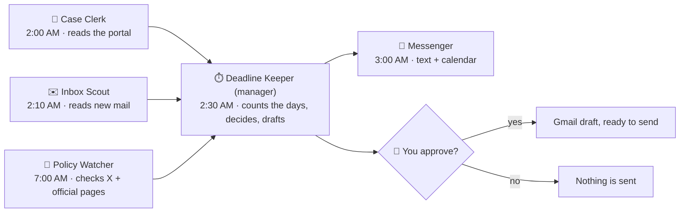

<div align="center">

# 🧭 waypoint

### Your visa deadlines, watched for you.

A team of Grok Bots that keeps international students on track with the immigration deadlines that can cost them their status. It checks the portal, the inbox and X overnight, then texts you only what needs you.

**[Live demo](https://waypoint-5o4r.onrender.com)** · **[2-min video]([VIDEO LINK])** · **[Pitch deck]([DECK LINK])** · **[Grok Bot session export]([SESSION EXPORT LINK])**

Berkeley × Stanford Grok Bot Hackathon · Best Student Use Case

Ria Sethi · Vihaan Bussa · Abhi Mokkapati · Bhargav Nemani

</div>

---

## At a glance

| | |
|---|---|
| **Who it's for** | International students on F-1, especially on OPT, where the clock is strictest |
| **The pain** | Strict, unforgiving deadlines spread across government portals with no alerts, an overflowing inbox and rule changes on X |
| **What it does** | 1 manager + 4 worker Grok Bots check everything overnight, compute every deadline, text you, add it to your calendar, and draft emails that wait for your approval |
| **Time saved** | Even 30 minutes a week × 335,785 students on OPT ≈ **168,000 hours back every week** |
| **Try it** | [waypoint-5o4r.onrender.com](https://waypoint-5o4r.onrender.com) → **Show me the demo** (no account needed) |

---

## 💡 Inspiration

For most college students, missing a deadline means losing points on an assignment. For an international student, it can mean losing the right to stay in the country.

We've watched our own friends live with that. [One or two sentences on what happened to them, in your own words.]

They weren't careless. The deadline lived in a PDF, a USCIS email or a portal nobody checks, and nothing warned them. One student told East-West Center researchers, *"if I mess one thing up, I'm gonna be deported."*

It isn't rare. Open Doors 2026 counted **1,146,163 international students** in the US this year, and **335,785 of them on OPT**, up 14% in a year. Every one of them is tracking these dates by hand.

## 🧭 What it does

Waypoint gives each student a team of Grok Bots that works while they sleep. You never have to open a dashboard; the important things come to you:

- 📱 **A text** when something changes: what changed, and how many days are left
- 📅 **A calendar event** for every deadline, moved when its date moves
- ✉️ **A drafted email** to your school, employer or attorney that is **only sent after you approve it**

### The Bot team: 1 manager, 4 workers

| Bot | Role | What it does | Grok Bot feature |
|---|---|---|---|
| ⏱️ **Deadline Keeper** | **Manager** | Takes the workers' reports, runs your visa's rules, decides what you need to know, drafts the next step | Handoffs, drafting |
| 🤖 **Case Clerk** | Worker | Logs into the case-status portal like a person and reads your status | The Bot's own computer |
| ✉️ **Inbox Scout** | Worker | Pulls receipt numbers, due dates and appointments out of USCIS, school and employer email | Gmail connector |
| 🦉 **Policy Watcher** | Worker | Watches X for rule changes, keeps only the ones that match your visa, confirms each on an official page | X search |
| 💬 **Messenger** | Worker | Texts you, syncs Google Calendar, saves approved emails to Gmail | Calendar connector, Twilio |

### One night, start to finish



### Every visa runs on its own clock

Each visa type is a **rule pack**: rows of clocks, limits and official sources. Change your status and Waypoint switches rule packs with you.

| Visa | Example clock | Status |
|---|---|---|
| F-1 | Apply for OPT from 90 days before your program ends to 60 days after | ✅ Built |
| OPT / STEM OPT | 90 days of unemployment allowed, 150 in total on STEM OPT | ✅ Built |
| H-1B | Up to 60 days to find a new sponsor, change status or leave after a layoff | ✅ Built |
| J-1 | 30 days to leave after your program ends | 🔜 Next |
| Green card | File Form I-751 in the 90 days before a two-year card expires | 🔜 Next |

### Safe by design

- 🧮 **AI never does the date math.** Plain code turns your dates and the official rules into days left, so the number is the same every time.
- 🙋 **Nothing reaches another person without your tap.** Texts and calendar events go only to you; emails wait as drafts until you approve.
- 🔒 **No ID numbers in texts.** Waypoint refuses any text that contains a receipt number or runs over 300 characters.
- 🔕 **No noise.** At most 6 texts a day, with quiet hours unless something is urgent.
- ⚖️ **Not legal advice.** Waypoint organizes, alerts and drafts. The demo uses made-up people and a mock portal.

## 🛠️ How we built it

| Layer | What we used |
|---|---|
| **Bots** | 5 Grok Bots built as shareable templates, running on daily schedules |
| **Connector** | Our own MCP server at `/mcp` (JSON-RPC over POST) with 12 tools and one key per account |
| **Server** | One Node 22 program with no dependencies: serves the pages, the connector, the mock portal and the report form |
| **Deadlines** | Rule packs as data in `public/js/rules.js`; a pure clock function in `public/js/clocks.js` |
| **Data** | JSON tables saved to Upstash Redis on every change |
| **Notifications** | Twilio for texts; Grok Bot's Google Calendar and Gmail connectors |
| **Hosting** | Render, redeployed on every push to `main` |
| **Accounts** | scrypt-hashed passwords, signed HttpOnly cookies, each account sees only its own rows |
| **Design** | Built in Cursor, checked with Impeccable's critique and detect tools |
| **Tests** | 39 tests covering the day counts, the rule packs, the connector, texting and the server end to end |

<details>
<summary><b>The 12 connector tools</b></summary>

| Tool | Used by | What it does |
|---|---|---|
| `list_people` | Every Bot | Who the key speaks for and how they want to be told |
| `get_brief` | Every Bot | Every deadline with days left and risk, already worked out |
| `report_run` | Every Bot | One plain line at the end of each run, even a failed one |
| `save_case_status` | Case Clerk | The status as worded, when it changed, any response date |
| `save_policy_alert` | Policy Watcher | A rule change, why it matters, the official link, the X post where it was first seen |
| `save_inbox_date` | Inbox Scout | A date from an email, with sender and subject |
| `set_deadline_note` | Deadline Keeper | A clearer reason under a deadline |
| `draft_email` | Deadline Keeper | Saves a draft. It can never send |
| `list_emails` | Deadline Keeper, Messenger | Drafted and approved emails, so nothing is written twice |
| `mark_email_delivered` | Messenger | Records the Gmail draft. Refused unless the person approved it |
| `log_message` | Messenger | Records a calendar event or a message |
| `send_text` | Messenger | Sends one text through Twilio and records it |

No tool accepts a day count: days left and risk only ever come out of `get_brief`.

</details>

## 🤖 How Grok Bot helped build it

- **Research:** [Real examples from the session export, e.g. Grok Bot checking each rule against the official USCIS and Study in the States pages, and reading X for current policy changes.]
- **Build:** [Real examples, e.g. coding tasks handed to Cursor, writing each Bot's first message, designing the connector's tools.]
- **Ship:** The Bots *are* the product. Each one is a Grok Bot template with its own job, schedule and connectors, writing through our MCP connector. Grok Bot's own computer lets Case Clerk operate a portal that has no API.

Full session export: **[SESSION EXPORT LINK]**

### Bot templates

| Bot | Template link |
|---|---|
| ⏱️ Deadline Keeper (manager) | [link] |
| 🤖 Case Clerk | [link] |
| ✉️ Inbox Scout | [link] |
| 🦉 Policy Watcher | [link] |
| 💬 Messenger | [link] |

## 🧗 Challenges we ran into

- **Government portals have no APIs.** We built a mock case-status portal and had Case Clerk use its own computer to log in and read it, the way a person would.
- **Getting Bots to write data reliably.** Our first plan used a shared Google Sheet. We replaced it with our own MCP connector, so every Bot gets named tools and the server can refuse a bad write.
- **Keeping AI away from the math.** A wrong day count is worse than none, so the Bots only read and draft. A small deterministic function computes every deadline.
- **Texts are sensitive.** We added hard limits so a text can never carry a receipt or ID number.
- **The free host sleeps.** The server takes up to a minute to wake, so the Bots wait and retry once.

## 🏆 Accomplishments we're proud of

- A live site where five scheduled Grok Bots hand off work end to end, from the portal to your phone
- Our own 12-tool MCP connector that any Grok Bot can plug into
- Rule packs that make a new visa type a matter of new rows, not new code
- A human approval step that no Bot can skip
- 39 passing tests and a design checked against Impeccable's rules

## 📚 What we learned

- AI is great at reading messy inputs and writing clear explanations, and should never be trusted with the date math.
- The manager Bot is what makes a team of Bots useful: workers collect, the manager decides, and only one Bot talks to the person.
- For high-stakes tools, the human check matters as much as the automation.
- The people with the strictest deadlines are often the ones with the least support.

## 🔭 What's next

- **More visa types:** J-1, O-1, L-1 and the green card path
- **New Bots:** Travel Checker (passport, visa stamp and travel signature before a trip), Form Drafter (prefills forms for you to review) and Advisor Liaison (a one-page case summary before you meet your school or attorney)
- **Approve by text:** reply YES to approve a drafted email
- **Real-world readiness:** encrypted storage for documents, attorney-reviewed rule packs with "last checked" dates, and carrier registration for texting at scale

## ▶️ How to run it

**Fastest:** open **[waypoint-5o4r.onrender.com](https://waypoint-5o4r.onrender.com)** and click **Show me the demo**. It shows two made-up people, one on F-1 OPT and one on H-1B, with no account needed. (The free host may take up to a minute to wake.)

**Locally** (Node 22, no dependencies to install):

```bash
git clone https://github.com/Vihaanbussa/waypoint-hackathon.git
cd waypoint-hackathon
npm start      # then open http://localhost:3000
npm test       # runs the 39 tests
```

**Optional settings** (environment variables):

| Variable | What it's for |
|---|---|
| `UPSTASH_REDIS_REST_URL`, `UPSTASH_REDIS_REST_TOKEN` | Keeps accounts and Bot runs across restarts |
| `TWILIO_ACCOUNT_SID`, `TWILIO_AUTH_TOKEN`, `TWILIO_FROM` | Turns on texting. Without them, `send_text` says texting is off |
| `SMS_DEMO_TO` | Sends the sample people's texts to the presenter's phone without showing the number |

**Connect your own Grok Bots:** create an account, open **Connect your Bots**, copy the connector address and your Bot key, and paste each Bot's first message into Grok Bot.

**Try the live change:** open `/portal/admin/`, set the status to *Request for Evidence Was Sent* with a due date, run Case Clerk, and watch the new deadline appear on the brief.

---

<div align="center">

**Waypoint organizes, alerts and drafts. It is not legal advice.**

Sources: [IIE Open Doors 2026](https://opendoorsdata.org) · East-West Center interviews with international students · Rules from USCIS and State Department pages

</div>
