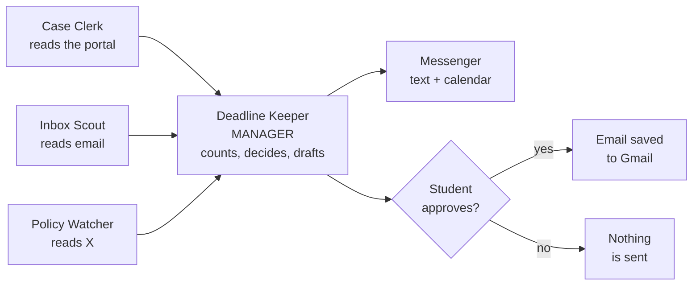

<div align="center">

# waypoint

### Your visa deadlines, watched for you.

**A team of Grok Bots that keeps international students from missing the immigration deadlines that can cost them their status.**

[**Try the live demo →**](https://waypoint-5o4r.onrender.com)

<sub>Berkeley × Stanford Grok Bot Hackathon · Best Student Use Case · Ria Sethi, Vihaan Bussa, Abhi Mokkapati, Bhargav Nemani</sub>

</div>

<br>

> [!IMPORTANT]
> **For most students, a missed deadline costs points. For an international student, it can cost the right to stay in the country.**
> Waypoint watches every deadline for them, so they never find out too late.

<br>

<div align="center">

| **1,146,163** | **335,785** | **90 days** | **168,000 hours** |
|:---:|:---:|:---:|:---:|
| international students in the US this year | of them on OPT, where the clock is strictest | of unemployment allowed on OPT before status is at risk | back every week if Waypoint saves each OPT student just 30 minutes |

<sub>Student counts: IIE Open Doors 2026. The 30 minutes is a conservative example, not a measurement.</sub>

</div>

---

## Inspiration

We've watched our own friends live with this pressure. They weren't careless. The deadline lived in a PDF, a USCIS email or a portal nobody checks, and nothing warned them.

> *"If I mess one thing up, I'm gonna be deported."*
> — an international student on OPT, interviewed by the East-West Center

And it isn't one set of rules. Every visa runs on its own clock, and the rules change the moment your status does. A student on OPT can be unemployed for 90 days. Lose an H-1B job and you get 60. Most people learn these numbers the hard way.

## What it does

Waypoint gives each student a team of five Grok Bots that works overnight. The student never has to open a dashboard. What matters comes to them:

- **A text** when something changes: what changed, and how many days are left
- **A calendar event** for every deadline, moved automatically when the date moves
- **A drafted email** to their school, employer or attorney, sent **only after they approve it**

### One manager, four workers

| Bot | Role | Job |
|---|---|---|
| **Deadline Keeper** | Manager | Combines the workers' reports, runs the student's visa rules, decides what matters and drafts the next step |
| **Case Clerk** | Worker | Logs into the case-status portal on its own computer and reads the status, like a person would |
| **Inbox Scout** | Worker | Finds receipt numbers, due dates and appointments in USCIS, school and employer email |
| **Policy Watcher** | Worker | Watches X for rule changes, keeps only the ones that affect this visa, and confirms each on an official page |
| **Messenger** | Worker | Texts the student, updates Google Calendar and saves approved emails to Gmail |



### Every visa runs on its own clock

Each visa type is a **rule pack** of deadlines, limits and official sources. When a student's status changes, Waypoint switches packs with them.

| Visa | A rule people miss | |
|---|---|---|
| F-1 | Apply for OPT from 90 days before your program ends to 60 days after | **Built** |
| OPT / STEM OPT | 90 days of unemployment allowed, 150 in total on STEM OPT | **Built** |
| H-1B | Up to 60 days to find a new sponsor, change status or leave after a layoff | **Built** |
| J-1 | 30 days to leave after your program ends | Next |
| Green card | File Form I-751 in the 90 days before a two-year card expires | Next |

> [!NOTE]
> **Built to be trusted.** AI never does the date math: plain code computes every deadline from the official rule. No Bot can send anything to another person; it waits for the student's tap. Texts never contain receipt or ID numbers. Waypoint organizes, alerts and drafts. It is not legal advice.

## How we built it

| | |
|---|---|
| **Bots** | Five Grok Bots, each a shareable template with its own job, schedule and connectors |
| **Connector** | Our own MCP server with 12 tools, so every Bot writes structured data and the server can refuse a bad write |
| **Server** | One Node 22 program with no dependencies: the app, the connector and a mock case-status portal |
| **Deadlines** | Rule packs stored as data, and a pure function that turns dates and rules into days left |
| **Data** | Upstash Redis |
| **Notifications** | Twilio for texts, Grok Bot's Google Calendar and Gmail connectors |
| **Hosting** | Render, redeployed on every push |
| **Quality** | 39 automated tests; design checked with Impeccable |

<details>
<summary><b>See the 12 connector tools</b></summary>
<br>

| Tool | Used by | What it does |
|---|---|---|
| `list_people` | Every Bot | Who the key speaks for and how they want to be told |
| `get_brief` | Every Bot | Every deadline with days left and risk, already computed |
| `report_run` | Every Bot | One plain line at the end of each run |
| `save_case_status` | Case Clerk | The status as worded, when it changed, any response date |
| `save_policy_alert` | Policy Watcher | A rule change, why it matters, and the official source |
| `save_inbox_date` | Inbox Scout | A date found in an email, with sender and subject |
| `set_deadline_note` | Deadline Keeper | A plain-language reason under a deadline |
| `draft_email` | Deadline Keeper | Saves a draft. It can never send |
| `list_emails` | Deadline Keeper, Messenger | Drafted and approved emails, so nothing is written twice |
| `mark_email_delivered` | Messenger | Records the Gmail draft, refused unless the student approved it |
| `log_message` | Messenger | Records a calendar event or message |
| `send_text` | Messenger | Sends one text through Twilio |

No tool accepts a day count. Deadlines only ever come from `get_brief`.

</details>

## How Grok Bot helped build it

Grok Bot is both how we built Waypoint and what Waypoint runs on.

- **Research.** We used Grok Bot to pull each visa rule from official USCIS, State Department and Study in the States pages, and to see how rule changes surface on X before anywhere else.
- **Build.** Grok Bot handed coding tasks to Cursor, helped design the connector's tools, and drafted each Bot's instructions: its job, where it looks, and what it must never do.
- **Ship.** The Bots are the product. Each one runs on a schedule inside Grok Bot. Case Clerk uses Grok Bot's own computer to operate a portal with no API, Policy Watcher uses X search, and Messenger uses the Calendar and Gmail connectors.

## Challenges we ran into

- **Government portals have no APIs.** We built a mock portal and had Case Clerk log in on its own computer and read it like a person.
- **Getting Bots to write data reliably.** A shared spreadsheet was too fragile, so we built our own MCP connector with named tools.
- **Keeping AI away from the math.** A wrong day count is worse than none, so the Bots only read and draft, and code does every calculation.
- **Texts are sensitive.** We added hard limits so a text can never include a receipt or ID number.

## Accomplishments we're proud of

- A live app where five scheduled Grok Bots hand off work end to end, from the portal to the student's phone
- Our own 12-tool connector that any Grok Bot can plug into
- Rule packs that make a new visa type a matter of new rows, not new code
- An approval step no Bot can skip
- 39 passing tests

## What we learned

- AI is excellent at reading messy inputs and explaining them clearly. It should never be trusted with the date math.
- A manager Bot is what makes a team of Bots useful: workers collect, the manager decides, and only one Bot talks to the person.
- In high-stakes tools, the human check matters as much as the automation.

## What's next

- **More visas:** J-1, O-1, L-1 and the green card path
- **New Bots:** a Travel Checker before trips, a Form Drafter that prefills forms for review, and an Advisor Liaison that writes a one-page case summary before meetings
- **Approve by text:** reply YES to approve a draft
- **Real-world readiness:** encrypted storage, attorney-reviewed rules, and carrier registration for texting at scale

## How to run it

**Fastest:** open [waypoint-5o4r.onrender.com](https://waypoint-5o4r.onrender.com) and click **Show me the demo**. No account needed. The free host can take up to a minute to wake.

**Locally** (Node 22, nothing to install):

```bash
git clone https://github.com/Vihaanbussa/waypoint-hackathon.git
cd waypoint-hackathon
npm start
```

Run the tests with `npm test`.

**Optional environment variables**

| Variable | Turns on |
|---|---|
| `UPSTASH_REDIS_REST_URL`, `UPSTASH_REDIS_REST_TOKEN` | Saving accounts and Bot runs across restarts |
| `TWILIO_ACCOUNT_SID`, `TWILIO_AUTH_TOKEN`, `TWILIO_FROM` | Text messages |
| `SMS_DEMO_TO` | Sending the demo's texts to the presenter's phone |

**Connect your own Grok Bots:** create an account, open **Connect your Bots**, copy the connector address and your Bot key, and paste each Bot's first message into Grok Bot.

---

<div align="center">
<sub>Waypoint organizes, alerts and drafts. It is not legal advice. Demo data is made up.</sub>
</div>
